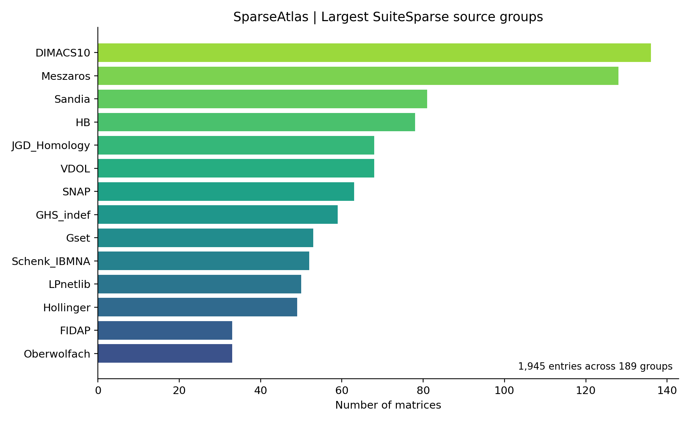
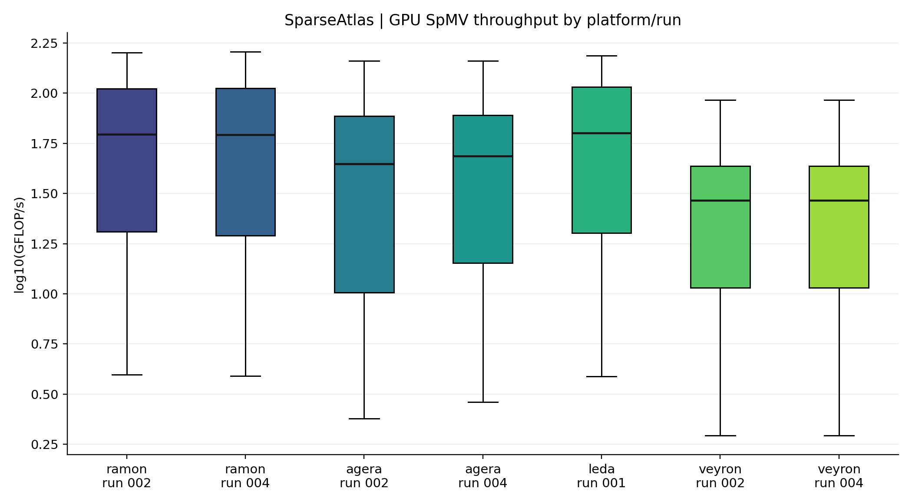
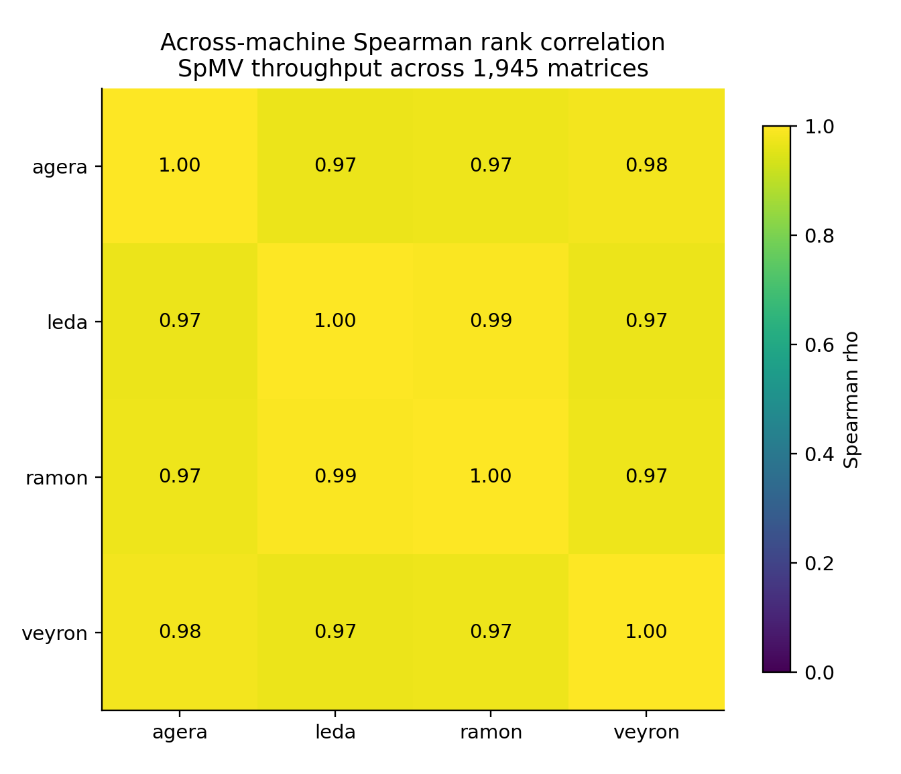
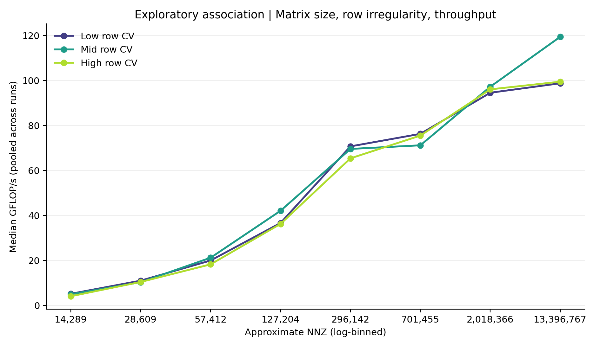

# Unified corpus: application and GPU performance characterization

This analysis uses the uploaded release-candidate `matrices.csv`, `structural_features.csv`, `spmv_results.csv`, and `platforms.csv`. It covers **all 1,945 matrix entries** and **all 13,615 observations**; the Core/Tier A origin is not used as a primary grouping.

## Validated input consistency

- Matrix metadata: **1,945** entries, **1,906** unique canonical hashes, **189** SuiteSparse source groups.
- Structural descriptors: **1,945** rows, **65** features, no missing cells.
- Performance: **13,615** records, seven platform/run combinations with 1,945 records each; **13,615** pass statuses and finite correctness flags.
- All matrix IDs join across the three main tables; performance canonical hashes agree per matrix.

## Source-collection diversity

**Figure A.** Largest source groups by number of entries. The corpus includes 189 groups, but a SuiteSparse group is a source/collection label, not necessarily a distinct scientific application domain. The uploaded release metadata does **not** include SuiteSparse `kind`, so application-kind diversity cannot yet be quantified.

See [group counts](analysis/group_counts.csv).

## Computational diversity

**Figure B.** Distribution of observed GPU SpMV throughput by platform/run (boxplots exclude individual outlier points). Runs have different GPUs, drivers, and libraries, so differences are descriptive rather than causal. All observations use the same recorded cuSPARSE CSR algorithm.

Pooled runtime 5th/median/95th percentile: **3.87 / 8.43 / 303.70 µs**. Pooled throughput 5th/median/95th percentile: **4.43 / 39.70 / 127.24 GFLOP/s**. Pooled CV median/95th percentile: **0.029% / 3.33%** (CV is stored as a fraction). These are observation-weighted pooled summaries, not normalized hardware comparisons.

**Figure C.** Spearman correlation of per-matrix throughput rankings across machines, after taking the median of repeated runs within each machine. This is a *descriptive* portability measure, not a transfer-learning evaluation. See [exact correlations](analysis/spmv_cross_machine_spearman.csv).

**Figure D.** Exploratory association between size, row irregularity, and throughput. Matrix entries are grouped into eight equal-frequency bins by NNZ; row irregularity (`row_cv`) is divided into three global quantile groups. Each matrix's median throughput across seven observations is used. This does **not** isolate a causal effect of irregularity or account for all structural confounders.

See [per-platform summary](analysis/spmv_platform_summary.csv).

## Interpretation and remaining tests

The corpus spans multiple source collections and shows measurable differences in GPU throughput and cross-machine performance rankings. This supports further investigation of structural performance modeling, but does not yet prove that structural features improve prediction beyond NNZ, dimensions, and density. Next: duplicate-aware train/test splits; NNZ-controlled modeling baselines; within-machine run consistency; structural neighborhood density and gap analysis; source-kind enrichment if `kind` metadata can be retrieved.
