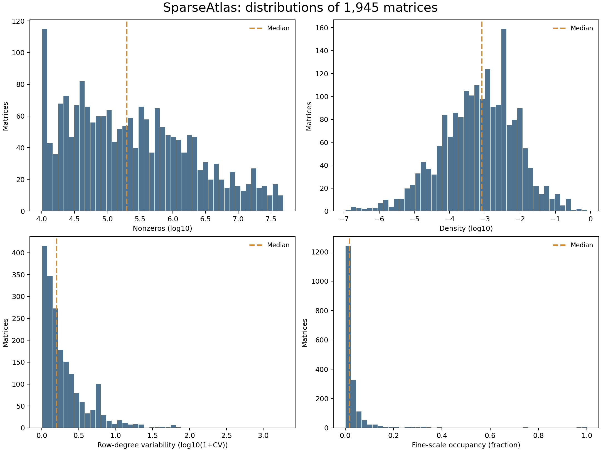
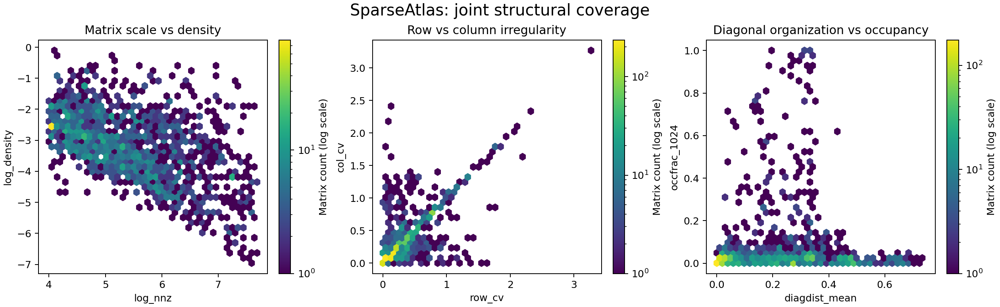
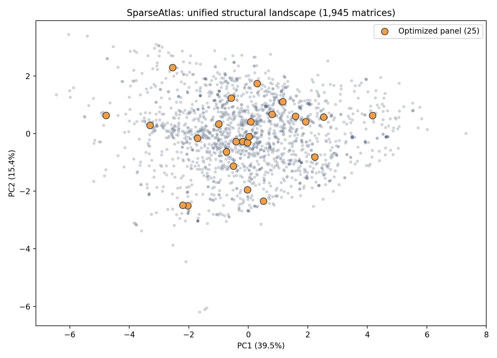
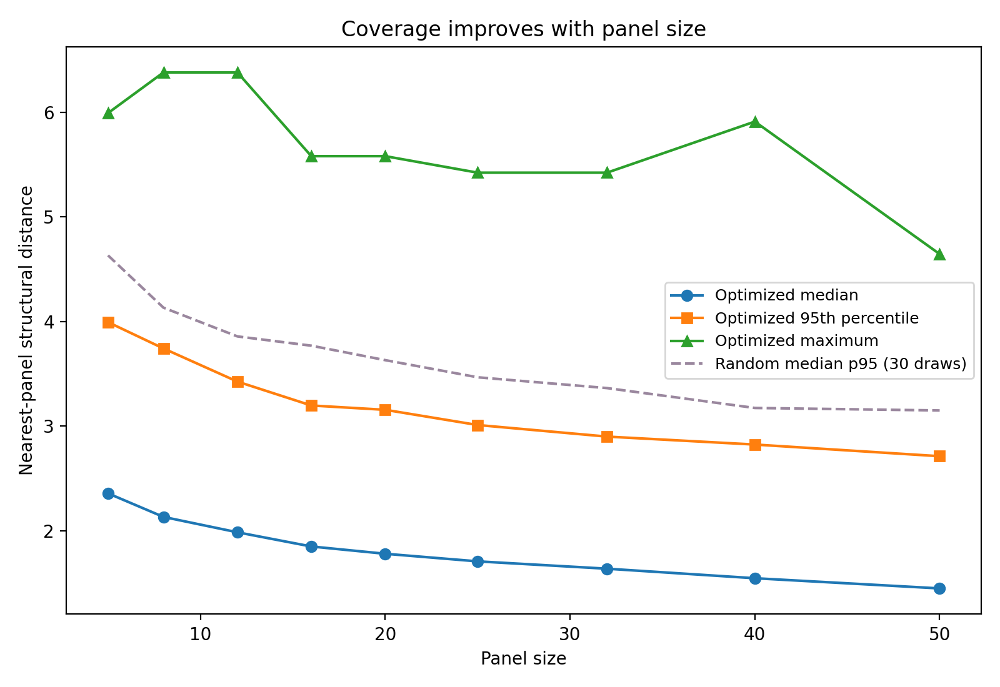
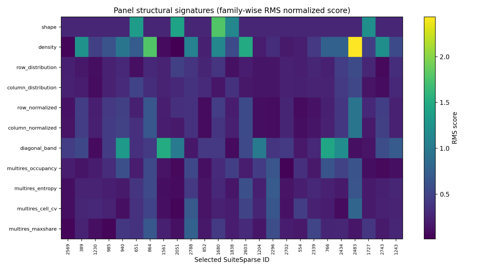
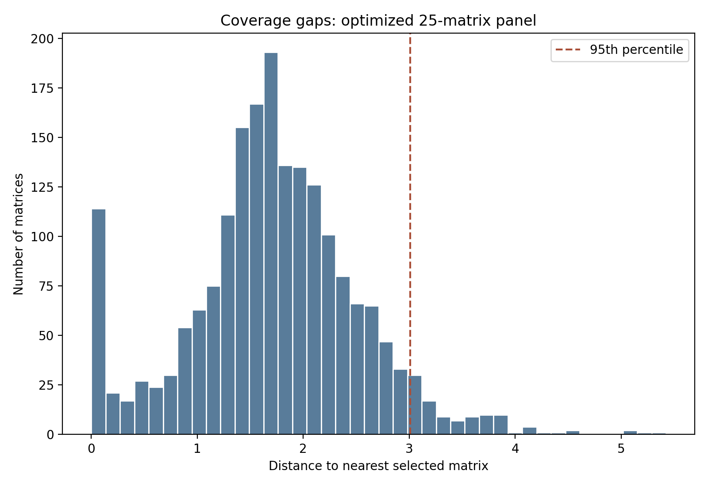

# SparseAtlas: Characterizing sparse computational structures

**Status:** Exploratory documentation (October 2026). **Scope:** Unified corpus of **1,945 matrices**, treating the original Core and Tier A as a single collection.

SparseAtlas is a curated resource connecting sparse-matrix structural characteristics with GPU sparse matrix-vector multiplication (SpMV) measurements. Its research goal is to understand how computational behavior depends on structure, and ultimately to support performance modeling, experimental design, and studies of hardware portability. The 25-matrix representative panel is one *optional downstream artifact*, not the primary dataset contribution.

## Dataset at a glance

| Property | Current scope |
|---|---|
| Matrix entries | 1,945 |
| Distinct canonical SHA-256 hashes | 1,906 |
| Structural descriptors | 65 per matrix (`struct-v1.0`) |
| Exploratory unified structural metric | 62 features, 11 balanced families |
| GPU SpMV observations | 13,615 (7 runs × 1,945 matrices) |
| Benchmark machines | `ramon`, `agera`, `leda`, `veyron` |
| Optional representative panel | 25 matrices |

The 62-feature metric is **refitted on the unified corpus** and does **not** replace the frozen `structural-distance-v1` used in corpus expansion. The 65 recorded descriptors and the 62-feature distance space are different objects.

## 1. Scale and structural distributions

**Figure 1.** Marginal distributions across all 1,945 matrices, without panel-based sampling. The corpus has substantial variation and long tails in nonzero count, density, row irregularity, and fine-resolution occupancy.

| Feature | Corpus median | Interpretation |
|---|---:|---|
| Nonzeros | 196,549 | Sparse computation scale |
| Density | 0.000805 | Fraction of possible entries that are nonzero |
| Row nonzero-count CV | 0.581 | Variation in row workload |
| Occupied fraction, R=1024 | 0.0162 | Fine-scale spatial occupancy |

These are descriptive summaries, not proof of representative sampling of all possible sparse matrices. A complete size/shape audit still needs the joint distribution of rows, columns, NNZ, and aspect ratios.

## 2. Joint structural diversity

**Figure 2.** Pairwise relationships between structural characteristics. Broad marginal ranges alone do not guarantee multidimensional coverage: joint distributions reveal which combinations are common, rare, or absent from this corpus.

**Figure 3.** PCA visualization of the exploratory unified 62-feature rank-normalized space. PC1 explains **39.5%**, PC2 **15.4%** of the transformed-space variance (approximately 55% together). Orange markers show the optional 25-matrix panel. **All quantitative nearest-neighbor distances are computed in the full feature space, not the PCA projection.**

## 3. Coverage dimensions and limits

SparseAtlas coverage should be evaluated along four complementary dimensions:

| Dimension | What the dataset can establish | Remaining analysis |
|---|---|---|
| **Scale and shape** | NNZ and density distributions | Rows/columns, aspect-ratio bins, joint size/shape regimes |
| **Structural diversity** | Irregularity, diagonal organization, multiresolution descriptors, exploratory PCA | Local neighborhood density, outliers, region stability, feature redundancy |
| **Application diversity** | SuiteSparse source group and kind metadata | Group/kind frequency, concentration, relation to structural regions |
| **Computational diversity** | Seven-run GPU SpMV dataset | Performance distribution, run variability, correctness, hardware rankings, structure–performance relations |

We should not report a percentage of *universal* sparse-matrix coverage without defining a reference population. SuiteSparse **groups** are collections or sources, not necessarily distinct scientific application domains; **kinds** also require careful interpretation.

## 4. Optional artifact: a 25-matrix representative panel

The exploratory panel was selected by greedy reduction in mean nearest-panel distance followed by local swaps. This is a heuristic and is not a globally optimal k-medoids solution. The selection did not use performance labels.

**Figure 4.** Nearest-panel distances versus panel size, with 30 seeded random panels per size. Independently refined panel sizes can have non-monotonic maximum-distance curves.

**Figure 5.** Family-wise RMS transformed-feature magnitudes for selected matrices. These magnitudes do not indicate the direction of deviation.

**Figure 6.** Full-corpus distances to the nearest selected panel matrix, in the exploratory 62-dimensional space.

| Nearest-panel distance | Earlier 25-matrix panel | Exploratory unified 25-matrix panel |
|---|---:|---:|
| Mean | 2.6673 | 1.7163 |
| Median | 2.6851 | 1.7069 |
| 95th percentile | 4.0890 | 3.0106 |
| Maximum | 7.5938 | 5.4233 |

Both panels were evaluated in the same newly fitted space. The practical 25-matrix panel with an estimated device-data cap of 0.25 GiB per matrix coincided with the unconstrained selection; this is **not** a guarantee of total GPU memory or runtime. The panel's ability to represent GPU performance remains untested.

## 5. Research uses

**Performance modeling.** Determine whether structural representations explain SpMV behavior beyond baseline predictors such as NNZ and dimensions.

**Hardware portability.** Compare matrix rankings and relative performance across GPU platforms, accounting for repeated-run variability and environment differences.

**Experimental design.** Select informative subsets for initial testing while retaining the full corpus for scientific evaluation.

**Future intelligent scientific workflows.** Explore uncertainty-aware calibration, performance-guided scheduling, and transfer to other kernels. These are research directions, not yet validated capabilities of this release.

## 6. Release and reproducibility

The independently validated `releases/v1.0.0-rc1` passed **36/36 engineering checks**, including validation of 1,945 structural artifacts. This does **not** prove scientific representativeness, measurement stability, or cross-platform generalization. The original release should remain unchanged.

The figures here are previously generated exploratory outputs. Their source numerical data, transformations, and caveats are described in [Methods and provenance](METHODS_AND_PROVENANCE.md). For the next scientific analysis, see [Coverage analysis plan](COVERAGE_ANALYSIS_PLAN.md) and [Figure index](FIGURE_INDEX.md).

## New: application and GPU performance analysis

See [unified application and performance characterization](APPLICATION_AND_PERFORMANCE.md), including four new data-derived figures and downloadable analysis tables.
